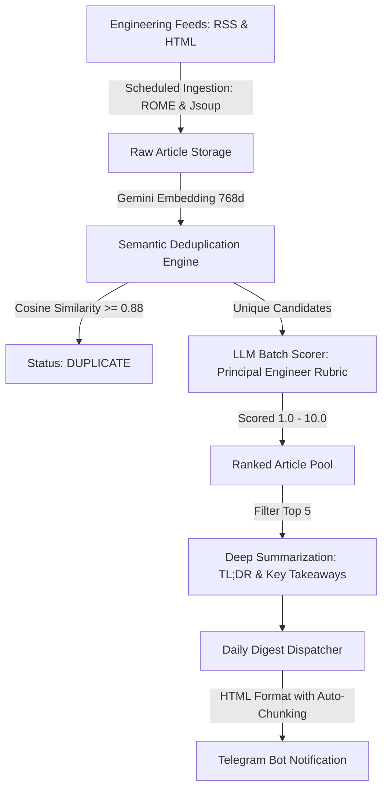
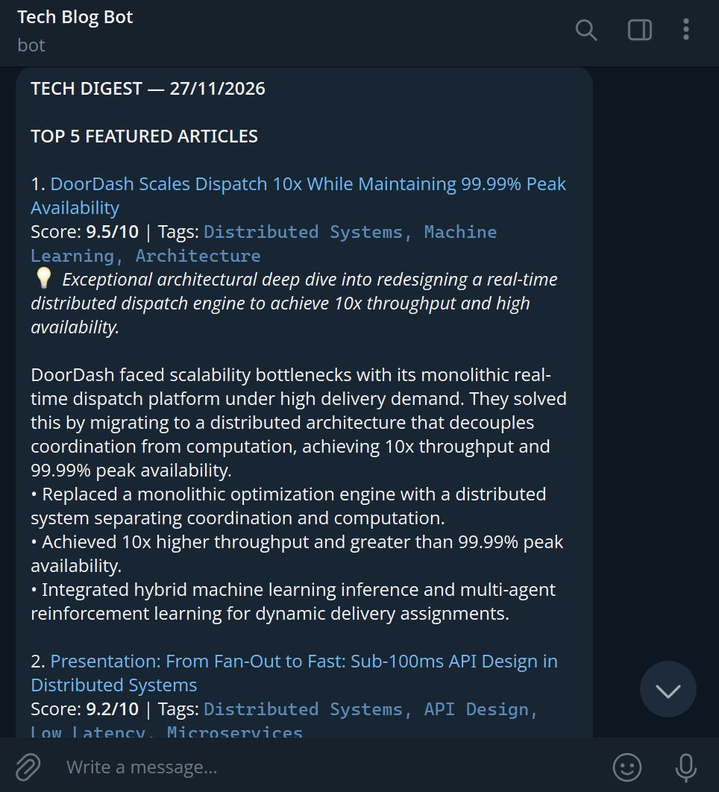

# TechBlogSuggestion

An automated, intelligent engineering blog curation and delivery service. TechBlogSuggestion continuously monitors premier engineering publications (Uber, Grab, InfoQ, etc.), eliminates semantic duplicates via pgvector embeddings, scores articles using LLMs evaluated against strict software architecture rubrics, produces concise technical summaries, and dispatches a curated morning digest directly to Telegram.

Designed for self-hosted environments and homelabs with strict memory constraints and high execution efficiency.

---

## Architecture Overview



---

## Processing Pipeline

The curation pipeline follows a cost-optimized, multi-stage funnel architecture:

### 1. Ingestion and Extraction
* Ingestion strategies handle both standard RSS/Atom feeds and dynamic HTML publication layouts.
* Clean body text extraction with Jsoup strips tracking tags, navigation menus, and boilerplate markup.
* Raw articles are normalized and stored with unique URL constraints.

### 2. Semantic Deduplication
* Generates a 768-dimensional dense vector representation for the title and content prefix using `gemini-embedding-001`.
* Performs cosine distance calculations against indexed articles published in the previous 48 hours using PostgreSQL `pgvector`.
* Articles with a cosine similarity score of 0.88 or greater are marked as `DUPLICATE` and excluded from scoring to eliminate cross-publication duplicate news.

### 3. Batch Scoring and Ranking
* Candidates are processed in batches of 15 articles to minimize API calls and latency.
* Evaluated by an LLM (`gemini-3.5-flash-lite`) configured with a Principal Backend Engineer persona.
* Articles are scored from 1.0 to 10.0 based on explicit technical criteria:
  * Engineering Depth (40%): Architectural trade-offs, scalability, GC/memory tuning, post-mortems. Basic tutorials and marketing announcements are penalized.
  * Tech Stack Relevance (30%): Distributed systems, Java/JVM, database internals, messaging, caching, and production AI engineering.
  * Actionable Insights (20%): Concrete benchmarks, performance statistics, and architectural patterns.
  * Novelty (10%): Fresh engineering approaches.

### 4. Deep Technical Summarization
* Only the top 5 highest-ranked unique articles are sent for full-content summarization.
* Generates:
  * A 2-sentence architectural TL;DR.
  * Three concrete takeaways with metrics, algorithms, and trade-offs.
  * Domain-specific tags.

### 5. Automated Telegram Delivery
* Compiles the top articles alongside quick links for secondary readings.
* Formats content in clean HTML with automatic character counting and message splitting (respecting Telegram's 4096-character limit).
* Dispatches messages via Telegram Bot API on a scheduled morning timetable.



---

## Technology Stack

* Language and Framework: Java 21, Spring Boot 4.x, Spring Data JPA, Virtual Threads
* Database: PostgreSQL 16 with `pgvector` extension
* Database Migrations: Flyway
* LLM and Embeddings: Google Gemini API (`gemini-3.5-flash-lite`, `gemini-embedding-001`)
* Web Scraping and Feed Parsing: ROME Tools, Jsoup
* Caching and Support: Redis 7
* API Documentation: SpringDoc OpenAPI / Swagger UI
* Containerization: Multi-stage Docker build, Alpine-based JRE, Docker Compose

---

## Pre-configured Feed Sources

The system seeds the following industry engineering publications by default:

| Source | Category | Type | Endpoint |
| :--- | :--- | :--- | :--- |
| Uber Engineering | TECH | HTML Scraper | `https://www.uber.com/us/en/blog/engineering/` |
| Grab Engineering | TECH | RSS Feed | `https://engineering.grab.com/feed.xml` |
| InfoQ | ARCHITECTURE | RSS Feed | `https://feed.infoq.com/` |

Additional sources can be registered dynamically via the REST API.

---

## Configuration

All configuration properties can be supplied via environment variables or an `application.yaml` file.

### Environment Variables

| Variable | Description | Example / Placeholder |
| :--- | :--- | :--- |
| `SPRING_DATASOURCE_URL` | JDBC URL for PostgreSQL | `jdbc:postgresql://<db_host>:<db_port>/<db_name>` |
| `DB_USER` | PostgreSQL username | `<your_db_username>` |
| `DB_PASSWORD` | PostgreSQL password | `<your_db_password>` |
| `DB_NAME` | PostgreSQL database name | `<your_db_name>` |
| `GEMINI_API_KEY` | Google AI Studio API Key | `<your_gemini_api_key>` |
| `TELEGRAM_BOT_TOKEN` | Telegram Bot token from @BotFather | `<your_telegram_bot_token>` |
| `TELEGRAM_CHAT_ID` | Telegram chat ID for notifications | `<your_telegram_chat_id>` |
| `TZ` | Container and scheduler timezone | `Asia/Ho_Chi_Minh` |

---

## Local Development and Setup

### Prerequisites

* JDK 21 or later
* Docker and Docker Compose
* Maven 3.9+ (or use included `mvnw`)

### 1. Start Database and Infrastructure

Start PostgreSQL with the `pgvector` extension and Redis:

```bash
docker compose up -d postgres redis
```

Flyway will automatically execute migrations to configure schemas, indexes (including HNSW vector indexing), and seed initial sources on application launch.

### 2. Configure Environment

Create a `.env` file in the project root:

```env
DB_NAME=<your_db_name>
DB_USER=<your_db_username>
DB_PASSWORD=<your_db_password>
GEMINI_API_KEY=<your_gemini_api_key>
TELEGRAM_BOT_TOKEN=<your_telegram_bot_token>
TELEGRAM_CHAT_ID=<your_telegram_chat_id>
DOCKERHUB_USERNAME=<your_dockerhub_username>
```

### 3. Build and Run

```bash
# Build the project
./mvnw clean package -DskipTests

# Run the application locally
./mvnw spring-boot:run
```

Once running, access Swagger UI at: `http://localhost:8080/swagger-ui/index.html`

---

## Docker Deployment (Homelab / Production)

The project includes an optimized multi-stage `Dockerfile` utilizing Eclipse Temurin JRE on Alpine Linux with SerialGC and tuned memory flags:

```bash
# Start the full stack with resource limits
docker compose --env-file .env up -d
```

### Resource Allocation

Configured specifically for homelab servers to run comfortably under 1GB total RAM footprint:

* Application Container: Memory limited to 450MB (`-XX:+UseSerialGC -Xmx320m -Xms128m`)
* PostgreSQL with pgvector: Memory limited to 350MB
* Redis: Memory limited to 64MB

---

## API Reference

### Ingestion

* `POST /api/v1/ingest/trigger`: Immediately runs ingestion across all active RSS and HTML sources.

### Curation

* `POST /api/v1/curate/trigger`: Executes semantic deduplication, LLM batch scoring, and top-article summarization on all unprocessed articles.

### Digest

* `POST /api/v1/digest/send`: Compiles the latest summarized articles and sends the digest to the configured Telegram chat immediately.

### Feed Sources Management

* `GET /api/v1/sources`: List all registered feed sources.
* `POST /api/v1/sources`: Register a new feed source (`name`, `rssUrl`, `category`, `sourceType`).
* `PATCH /api/v1/sources/{id}/toggle`: Toggle active status of a feed source.

---

## Scheduling Schedule

Automated background jobs are managed by Spring's TaskScheduler with explicit timezone binding (`Asia/Ho_Chi_Minh`):

* Ingestion Job: Runs every 4 hours (`08:00`, `12:00`, `18:00`, `22:00`, `02:00`, `06:00`).
* Curation and Digest Job: Runs daily at `07:30 AM`. Curates all ingested content from the night and delivers the morning digest before business hours.

---

## License

This project is licensed under the MIT License.
